# UI specification: Sunrise Passport

The visual specification of the TripTrackr app, written against the pictures in [`screens/`](./screens). It says
**what each screen looks like and how it must behave**; [`IMPLEMENTATION-PLAN.md`](./IMPLEMENTATION-PLAN.md) says in
what order to build it, and `../contracts/*` holds the as-built API of every component.

How to read it:

- **Units** are dp on the reference phone, **390 × 844** (a picture is 780 × 1688 px: divide by 2). Safe areas: top
  54, bottom 34.
- **Tokens** are written with the prototype's names (`paper`, `cream`, `ink`, `coral`...). Section 2.1 maps them
  to the app's names (`surface`, `surfaceSecondary`, `foreground`...). Never write a colour literal in a screen.
- **Pictures** are named by file: `core/home.png` is `screens/core/home.png`.
- **Not built** marks something a picture shows that this project does not build (section 10). Do not draw it and do
  not leave a control that does nothing.

---

## 1. Principles

1. **Photo-first, calm chrome.** Photographs and the globe are the content; chrome is white, cream and navy, with
   one coral action per screen state.
2. **One primary per screen state**: a coral pill (`Button primary`, the FAB, a sticky Save). Everything else is
   secondary, tonal or text.
3. **Everything legible on a photograph sits on a scrim or a disc.** Text over a hero uses the caption scrim;
   controls over a photograph are 44 dp discs on `scrimButton`; the status bar sits under the top scrim.
4. **Colour never carries meaning alone**: a status has a word, an error has an icon and a verb, a sync state has a
   glyph and a label.
5. **Nothing is "saved" until it is uploaded**: unsynced records show "Not yet synced" (the sync chip and the badge);
   this look never claims more.
6. **Four themes, intentional in each**: Sunrise (light), Nightfall (dark), and an increased-contrast version of each.
   The contrast themes are opaque (no glass, no blur) and reach 7:1 for text.
7. **Reflows at every text size**: no fixed heights on anything that holds text; minimums only.

## 2. Foundations

### 2.1 Colour

Light "Sunrise" values; the other three themes are in `prototype/tokens.css` and
`apps/mobile/src/theme/palette.data.js` (the source of the generated stylesheet; the contrast gate
`test/theme/contrast-gate.test.ts` measures every pair).

| Prototype token | App token (`useAppearance().tokens`) | Light     | Dark      | Use                                                        |
| --------------- | ------------------------------------ | --------- | --------- | ---------------------------------------------------------- |
| `paper`         | `surface`                            | `#FFFFFF` | `#0F2037` | Screen, sheet and card ground                              |
| `cream`         | `surfaceSecondary`                   | `#FFF1E3` | `#182E4A` | Tiles, field fill, segment track, raised rows (+ hairline) |
| `sand`          | `sand`                               | `#EBDCC9` | `#2B4466` | Decorative only: dashes, perforation, tracks, skeleton     |
| `ink`           | `ink`                                | `#0E2A47` | `#F4F7FB` | Text, icons, selected fills                                |
| `ink-2`         | `muted`                              | `#4A5B6E` | `#A4B3C4` | Secondary text                                             |
| `ink-3`         | `subtle`                             | `#566779` | `#93A5BA` | Tertiary, meta                                             |
| `coral`         | `accent`                             | `#FF6B4A` | `#FF8266` | Primary fill; text on it is `accentInk` (navy)             |
| `coral-press`   | `accentPress`                        | `#FF8466` | `#FF9A80` | Pressed fill (lighter)                                     |
| `coral-line`    | `accentLine`                         | `#E04A33` | `#FF8266` | Graphics at 3:1: edge ring, visited stroke, active node    |
| `coral-text`    | `accentText`                         | `#B92A1D` | `#FFA08C` | Coral as text or icon                                      |
| `coral-tint`    | `accentTint`                         | `#FFE9E1` | 16% coral | Selected tab pill, chip tint                               |
| `aqua`          | `aqua`                               | `#35C9D6` | `#35C9D6` | Water. Fills only, never text or a line                    |
| `aqua-line`     | `aquaLine`                           | `#1A8FA0` | `#46D5E0` | Aqua graphics                                              |
| `aqua-ink`      | `aquaInk`                            | `#0B6F7C` | `#5FDCE6` | Aqua as text (privacy chip, privacy line)                  |
| `amber`         | `amber`                              | `#FFB547` | `#FFC25E` | Planned fill or ring on photographs                        |
| `amber-line`    | `amberLine`                          | `#B86E00` | `#FFC25E` | Planned graphics on paper                                  |
| `amber-ink`     | `amberInk`                           | `#8A5200` | `#FFC25E` | Text on `amberTint`                                        |
| `danger`        | `danger`                             | `#9F1239` | `#FF8FA8` | Error text and icon. Always icon + verb                    |
| `success-ink`   | `success`                            | `#0D6B4C` | `#55DDA8` | Synced, ready                                              |
| `hairline`      | `hairline`                           | 12% ink   | 14% white | Divider, card edge                                         |
| `field-border`  | `border`                             | `#6B7D93` | `#7A90AB` | Field boundary (3:1)                                       |
| `focus`         | `focus`                              | `#D93A2E` | `#FFB4A0` | 2.5 dp ring, 2 dp offset                                   |

The primary coral fill on white is **2.82:1**, below the usual 3:1 for a control's edge, so every primary button,
the FAB and a selected coral fill carry a 1.5 dp edge ring in `accentLine` (FR-069, `PrimaryEdgeRing`). Do not
"fix" the coral by darkening it.

Scrims (the only gradients, defined in `src/theme/scrim.ts` and drawn by `components/ui/scrim.tsx`):

| Scrim     | Where                          | Stops (light)                                                                       |
| --------- | ------------------------------ | ----------------------------------------------------------------------------------- |
| `top`     | Under the status bar, 120 dp   | `rgba(8,26,48,.68)` held to 44%, then to 0                                          |
| `bottom`  | Over a photograph's lower part | 0 → .38 @ 25% → .66 @ 55% → .88 @ 100% (white text ≥ 5.3:1 on a white photograph)   |
| `caption` | Under hero text                | 48 dp ramp 0 → .66, then a solid block .66 → .88 that wraps the text                |
| `sky`     | Home and Welcome backdrop      | Warm peach top-right glow over a peach → aqua vertical ramp (dark: navy ramp)       |
| `cover`   | Generated covers               | Three palettes (navy-teal, red-orange, teal-navy) at 135° plus an amber corner glow |

### 2.2 Type

Three families, six embedded files: **Bricolage Grotesque** 600 and 700 (display), **DM Sans** 400, 600, 700 (body),
**Instrument Serif** Italic 400 (accent). Weights are 400, 600 and 700 only.

| Role       | Size / line | Family and weight        | Tracking | Notes                                                                        |
| ---------- | ----------- | ------------------------ | -------- | ---------------------------------------------------------------------------- |
| `display`  | 40 / 44     | Bricolage 700            | −.025em  | Home greeting, large titles                                                  |
| `numeral`  | 36 / 40     | Bricolage 700            | −.03em   | Tabular figures; capped at 1.2× text scale in the pictures (1.3× in the app) |
| `title`    | 28 / 32     | Bricolage 700            | −.02em   | Trip title, screen titles                                                    |
| `headline` | 22 / 28     | Bricolage 700            | −.01em   | Section titles, year headers                                                 |
| `callout`  | 17 / 22     | Bricolage 600            | 0        | Card titles, buttons                                                         |
| `body`     | 16 / 24     | DM Sans 400 (600 strong) | 0        |                                                                              |
| `label`    | 14 / 20     | DM Sans 400 (600 bold)   | 0        | Meta lines, chips                                                            |
| `caption`  | 13 / 18     | DM Sans 600              | 0        | Pills, helper text                                                           |
| `eyebrow`  | 12 / 16     | DM Sans 700, caps        | +.06em   | Kickers: "WED 14 OCT", "PORTUGAL · 3 STOPS"                                  |
| `accent`   | inherits    | Instrument Serif italic  | 0        | **One word per screen**: "Hello, _Marta_"                                    |

Every size scales with the system text size. Only tab labels, chip captions and hero numerals cap at 1.3×
(owner answer Q-1); their accessible names carry the rest.

### 2.3 Space, radius, elevation, icons

- **Space**: 4, 8, 12, 16, **20 (screen margin; 16 on an Android list)**, 24, 32, 40. Between sections 24 (32 above a
  major heading), between cards 16, inside groups 8 or 12.
- **Radius**: 8, 12 (inputs), 16 (thumbnails, tiles), **24 (cards, hero, ticket)**, **28 (sheets)**, full (buttons,
  chips, the tab pill). Inner radius = outer radius − padding (minimum 8).
- **Elevation**, two levels only: `lift1` (card, tile) and `lift2` (FAB, tab pill, callout, sheet, toast). In the
  dark themes a lift is a 1 px light ring plus a tonal shadow. Android draws them as `elevation` where the CSS
  `boxShadow` is not available.
- **Icons**: 24, 20 and 16 dp only; stroke 1.75 (16 dp: 2.0); round caps and joins. The prototype draws Lucide-style
  glyphs; the app draws the same meanings with **Phosphor** (`regular`, `bold` for 16 dp, `fill` for a selected tab)
  through the registry `components/ui/icon.tsx`. Directional glyphs mirror in a right-to-left layout.
- **Motion**: press scale .97 in 100 ms; sheet and capsule springs; count-up once per appearance; the live pin pulse;
  stamp landing once per session. Under reduced motion all of these are removed (state changes switch at once).

### 2.4 Platforms

|              | iOS                                                                     | Android                                                         |
| ------------ | ----------------------------------------------------------------------- | --------------------------------------------------------------- |
| Tab bar      | Floating pill: 64 dp tall, 16 dp from the sides, 24 dp up               | Full-width bar: 64 dp + 24 dp inset, 56 × 32 selected indicator |
| Surface      | Glass on iOS 26, blur earlier, solid in contrast / reduced transparency | Opaque `surfaceSecondary` with a hairline, no blur              |
| FAB          | Pill, 52 dp                                                             | Rounded square (radius 16), 56 dp                               |
| Titles       | Large native title (40 / 44), collapses on scroll                       | Standard 28 / 32 header                                         |
| Sheet handle | 36 × 5                                                                  | 32 × 4                                                          |
| List margin  | 20                                                                      | 16                                                              |

---

## 3. Components

Measurements are the prototype's (`prototype/styles.css`, `extra/extra.css`). "Min" means a minimum: the control
grows with text.

### 3.1 Buttons

| Variant       | Look                                                                               | Notes                                                                                                   |
| ------------- | ---------------------------------------------------------------------------------- | ------------------------------------------------------------------------------------------------------- |
| `primary`     | Coral fill, navy label, `callout`, full radius, min 52 (56 large), padding 12 × 24 | Pressed: lighter coral and scale .97. Disabled: `sand` fill, `subtle` label. Busy: spinner, same colour |
| `secondary`   | Transparent, 1.5 dp `ink` ring, `ink` label                                        | Pressed fills `surfaceSecondary`                                                                        |
| `tonal`       | `surfaceSecondary` fill with a hairline ring                                       |                                                                                                         |
| `text`        | No fill, min 44, padding 10 × 12                                                   |                                                                                                         |
| `destructive` | `dangerTint` fill, `danger` label, with an icon                                    | Always icon + verb                                                                                      |

Small buttons (44 min, `label` 600) exist in forms. Icons inside buttons are 20 dp, stroke 2. Focus ring: 2.5 dp,
2 dp offset, `focus`.

**FAB** ("Plan a trip" or a plus): coral, `lift2`, right 16, bottom = tab zone (88) + 16, hides when the keyboard is
open. The mini FAB (Home peek) is 56 × 56 with no label.

### 3.2 Icon buttons

44 × 44, full radius. Variants: `default` (paper, `lift1`), `tonal` (cream + hairline), `ghost`, `glass` (over a
photograph: `scrimButton` fill with a white 26% inner ring and a white icon), `onSky` (92% white or navy disc).

### 3.3 Chips and pills

| Component       | Look                                                                                                                                                                                                        |
| --------------- | ----------------------------------------------------------------------------------------------------------------------------------------------------------------------------------------------------------- |
| `Chip`          | Min 40 (hit area 44), padding 8 × 16, cream + hairline, `label` 600; selected = `ink` fill and `onInk` text (no hairline); dashed variant for "Other"                                                       |
| `SegmentedPill` | Track cream + hairline, padding 4, thumb `ink`, items min 36, equal widths; counts are tabular                                                                                                              |
| `StatusChip`    | Min 28, padding 4 × 10 × 4 × 8, `caption`: _Active_ cream + live dot; _Planning_ `amberTint` + `amberInk`; _Past_ cream + `muted`; synced `successTint`; error `dangerTint`; private `aquaTint` + `aquaInk` |
| `SyncChip`      | One per screen, top right, min 36, 92% white with `lift1`; states: waiting "N" (cloud-upload), syncing, offline (amber ink), failed (danger ring + Retry)                                                   |
| `SyncBadge`     | Per record: "Not yet synced" with an icon, never colour alone                                                                                                                                               |
| `FlagChip`      | 20 × 14 flag (28 × 20 large), radius 3, hairline; platform emoji flags are clipped to this box                                                                                                              |
| `PrivacyChip`   | Aqua tint, lock icon, "Only you"                                                                                                                                                                            |

### 3.4 Cards and rows

| Component               | Look                                                                                                                                       |
| ----------------------- | ------------------------------------------------------------------------------------------------------------------------------------------ |
| `Card`                  | Variants `lift` (paper, radius 24, `lift1`), `tile` (cream + hairline), `flat`, `overMap` (opaque), `pending` (dashed edge)                |
| `ListGroup` / `ListRow` | Cream tile, rows min 60, hairline separators, chevron in `subtle`                                                                          |
| `StatTile`              | Figure `numeral` over a `caption` label; three across with hairline separators                                                             |
| `AreaPill`              | Min 72 high, radius 16, cream + hairline, icon 24 over count and label; lock badge top right (aqua), warn ring and dot for a failed upload |
| `Banner`                | Radius 16, padding 8 × 12, `caption`; offline `amberTint`/`amberInk`; error `dangerTint`/`danger`; Retry is an underlined action           |
| `Toast`                 | Navy (`toastSurface`) 16 dp from the sides, 8 above the tab zone, min 52, action coral, 3 dp countdown bar                                 |

### 3.5 Fields

Label `label` 600 above (optional hint in `subtle`, right-aligned). Input: min **56**, padding 12 × 16, radius 12,
cream fill, 1 dp `border` ring, `body`. **Focus**: paper fill with a 2.5 dp `focus` ring 2 dp off. **Error**:
1.5 dp `danger` ring plus an icon and a sentence under it. Helper text 13 / 18 in `muted`, with a 16 dp icon.

### 3.6 Sheet, handle, forms

Sheet: paper, radius 28 at the top, `lift2` plus a top hairline. Handle: 36 × 5 in `grab` inside a 28 dp zone, with a
96 × 48 hit area. A **form sheet** has Cancel (ink, left), title (centred, `callout`), content padded 20, and a
sticky primary above the keyboard.

### 3.7 Tab bar

iOS pill: 64 dp, radius full, padding 6, translucent white (84%, blur 24, saturate 1.6) with a hairline ring and
`lift2`; three equal tabs **Globe, Trips, You**; selected = `accentTint` capsule behind a filled icon and an `ink`
label (12 / 14, capped). Android bar: cream, hairline on top, 56 × 32 indicator at 26% coral. A 48 dp fade of the
ground colour sits above the pill on lists.

### 3.8 Scrims, photographs

Photographs fill their frame (`cover`) and are never covered by a control on a grid; a count ("+9") sits on a scrim
that covers the whole tile.

### 3.9 Generated cover and stamps

- **Generated cover** (a trip with no photograph): one of three gradients picked by a hash of the trip id, the
  country code in 120 px type at 16% white bottom-right, a rotated stamp, an amber glow. Thumbnails show a 40 px
  code in 90% white.
- **Stamp** (the You screen): a deterministic passport stamp per country and date, rotation between −8° and 8°,
  wear and perforation from the hash. 124 dp wide in a two-column page, the second column 20 dp lower.

---

## 4. Home (`(tabs)/index`)

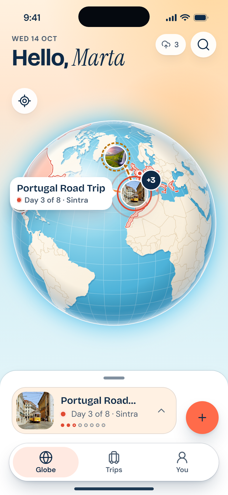
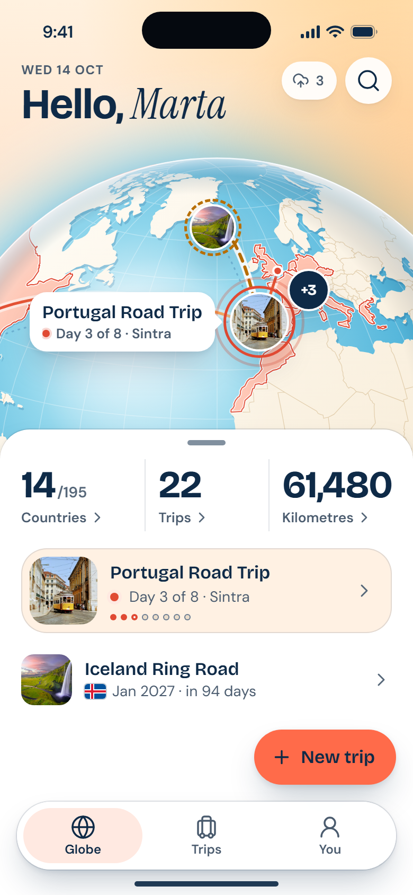
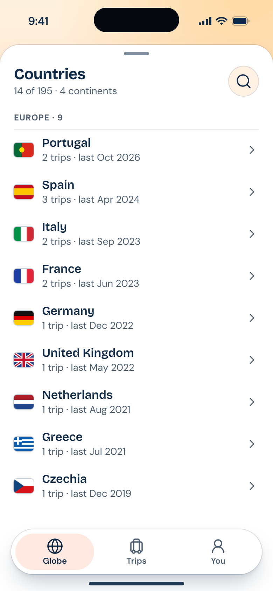
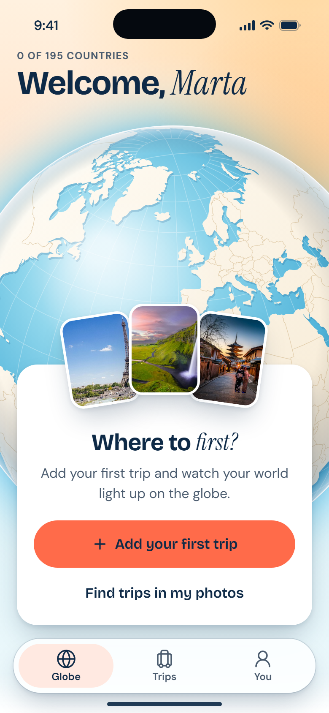

Frames: `home-peek`, `home` (half), `home-full`, `home-empty`, `home-loading`, `home-offline`, `home-error`,
`home-dark`, `home-android`, `home-contrast`, `home-long`, `home-scale2`, and the dark variants.

**Layers, bottom up**: sky → the globe (full bleed, wider than the screen) → pins and the callout → greeting header →
sheet → FAB → tab pill. The globe stays mounted in every state (empty, loading, error).

- **Header** (no native header): top inset 54, padding 20. An `eyebrow` date ("WED 14 OCT") over a `display`
  greeting "Hello, _Marta_" (two lines at most; the name is the serif accent). Right: the sync chip (36). After
  the traveller moves the globe, a 44 dp recentre control appears at the left margin below the header. The header
  is hidden at the full detent.
- **Sheet** has three positions: **peek 212 dp**, **half 52% (439 dp)**, **full** to the top inset + 10. The camera
  re-fits once when the sheet settles (280 ms). At peek the planet is large (radius 175 on the reference phone);
  at half it sits under the header (radius clamp(0.95 × free band, 150, 286)).
- **Peek content**: the Now card (cream, radius 24, padding 8: 56 dp thumbnail, trip name `callout`, a coral live dot
  "Day 3 of 8 · Sintra", a row of progress dots) with the mini FAB to its right.
- **Half content**: the three figures (countries, trips, kilometres; `numeral`, tabular, counted up once, hairline
  separators), the Now card (64 dp thumbnail), and "Up next" rows (48 dp thumbnail, chevron).
- **Full content**: the **Countries** list: title, "14 of 195 · 4 continents", sticky continent labels ("EUROPE ·
  9"), rows with a flag, the country, "2 trips · last Oct 2026" and a chevron (min 60). The FAB hides, rotation
  pauses, the camera does not move.
- **Pins**: photograph roundels (48 dp, 2 dp white ring, `lift2`); the active trip has a coral ring and a slow pulse;
  planned trips have a dashed amber ring; clusters are navy discs with a count. Roundels need a device spike; until
  it passes the app draws coloured dots. The **callout** is a white card with the trip name and "Day N of M · place".
- **Globe look**: peach-to-aqua sky, cream land, blue sea with a lighter rim glow, a faint graticule, visited
  countries outlined in coral, planned in dashed amber, trip arcs as coral-to-amber gradients, and an atmosphere
  halo. In the app this is a **Mapbox Standard globe** restyled through its documented config keys, so land and sea
  are _close to_ the pictures but not pixel-identical (the pictures were drawn with D3).
- **Empty**: the globe, then the invitation card 20 from the sides above the tab zone, radius 24, `lift2`, with
  three empty photo frames fanned over its top edge, the existing headline and one primary button.
- **Loading**: a skeleton shaped like the sheet; the disc is already positioned. **Offline / error**: a slim banner
  under the greeting; the chip changes with it; the globe keeps working.
- **Text scale ≥ 1.15**: figures become one column (label left, number right, hairline between); header tools stack;
  thumbnails shrink to 56 and 48.

**Must keep**: `home-screen`, `globe-map`, `globe-stats`, `globe-stat-countries` (the plain number), `globe-stat-distance`,
`globe-empty-state`, `globe-notice`, `home-plan-trip`, `home-add-stop`, `home-open-trips`, `home-overlay`.

## 5. Trips (`(tabs)/trips`)

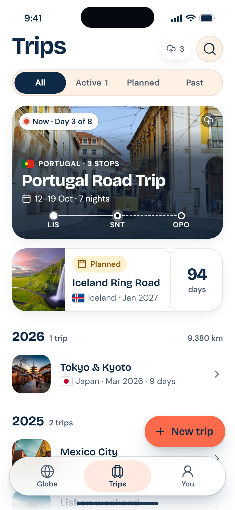
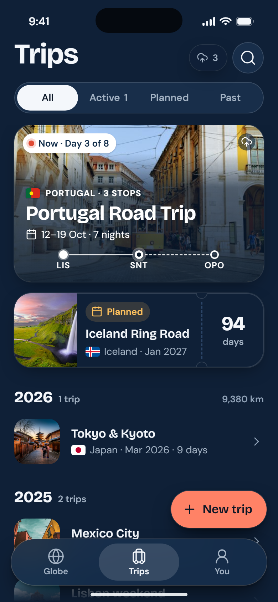
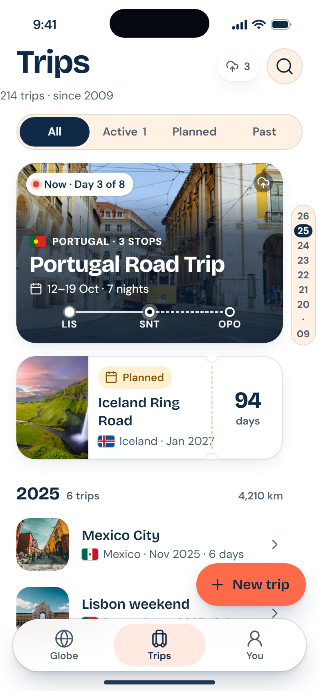
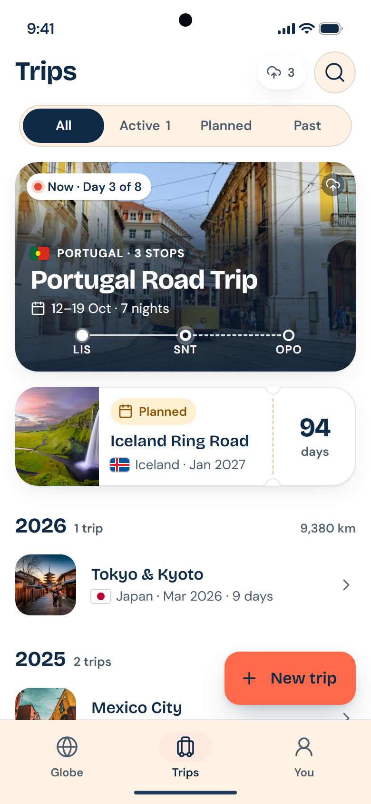

- **Header**: large title "Trips" (iOS, `display`) with the count as a trailing `caption`; the sync chip trailing.
  **Not built**: the search button.
- **Filter**: a `SegmentedPill` — All, Active (1), Planned, Past — with counts over the whole list that do not move
  with the filter.
- **Hero card** (the active trip only): min 219 high, radius 24, `lift1`, cover photograph with the bottom scrim.
  Top-left chip "Now · Day 3 of 8" (white, live dot); top-right a sync glyph if unsynced. Bottom: flag +
  "PORTUGAL · 3 STOPS" (`eyebrow`), the title (`title`), the dates and nights with a calendar icon, then the **stop
  strip**: dots joined by a dashed line (done solid, now ringed, next hollow) with IATA-style codes.
- **Ticket card** (the next planned trip): min 96, radius 24; 88 dp thumbnail, text block (planned chip, title,
  flag and "Iceland · Jan 2027"), and an 88 dp **stub** after a 2 dp dashed `sand` edge with two canvas-coloured
  notch circles, showing "94 days".
- **Rows by year**: a year header (`headline` 22 + "1 trip" `label` + km at the right, sticky on paper), then rows
  (min 72, 64 dp thumbnail radius 16, title, flag + "Japan · Mar 2026 · 9 days", chevron). Gap 16 between cards,
  12 between rows.
- **Year strip**: a right-edge scrubber (right 4, top 250) with 200 or more trips only.
- **FAB**: coral "New trip" pill above the tab zone (the app's existing name and id are "Plan a trip",
  `trips-plan-trip`; keep the app's text, `UI-SPEC` section 10).
- **List padding**: bottom = tab zone 88 + 16 + FAB 52 + 16 = **172** (176 on Android), so nothing hides behind the
  pill or the button.
- **States**: loading skeleton (hero, ticket, rows), "No trips yet" with the primary, filtered-empty ("No planned
  trips" + "Show all trips"), offline and error banners, a toast pattern, pending trips carry the sync badge.
- **Text scale ≥ 1.15**: the ticket becomes a column (thumbnail 88 high, text, stub as a row under a dashed top edge,
  notches hidden); meta lines take two lines; row thumbnails 56.

**Must keep**: `trips-screen`, `trips-plan-trip`, `trips-list` (populated only), `trips-empty-plan-trip`,
`trips-fab-clearance`, `trip-card-<id>` (label "title, status, N stops"), `status-pill-<status>`.

## 6. Trip (`trip/[id]`)

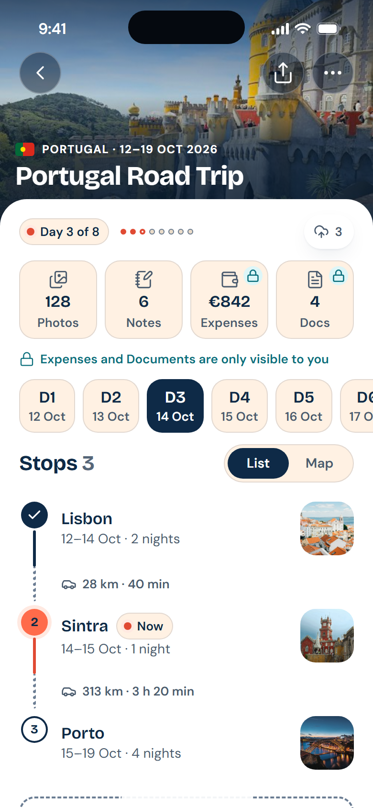
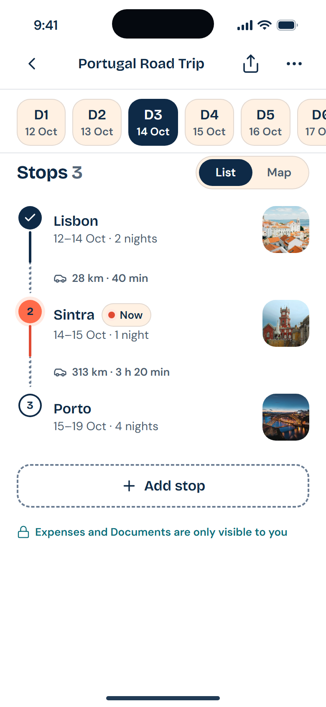
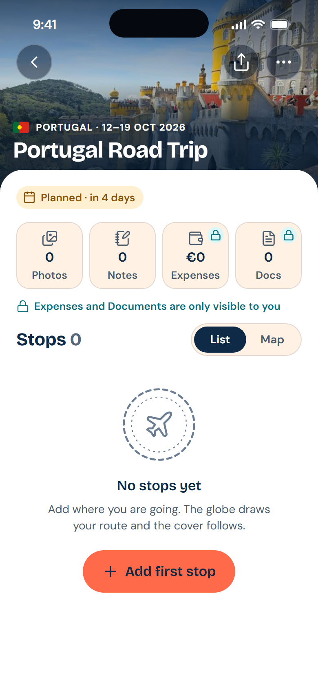
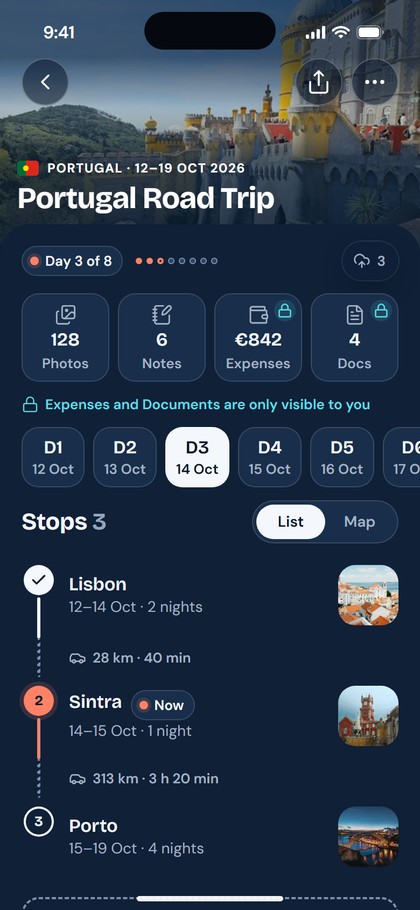

- **Header**: transparent; the only control is the glass Back disc (44 dp), named "Back". The status bar sits under
  the 120 dp top scrim. **Not built**: share and "more" buttons, a List/Map toggle.
- **Hero**: min 236, padding-top 100, full-bleed cover (or generated cover); eyebrow with a flag chip and
  "Portugal · 12–19 Oct 2026" (white); the title (`title`, two lines, grows upward) inside the caption scrim with
  36 dp bottom padding; **parallax .5**, stretches on a pull.
- **Sheet** overlaps the hero by 28: paper, radius 28, padding 16 20 0, gap 12.
- **Progress row** (min 36): status chip, "Day 3 of 8" with dots, the sync chip at the right.
- **Areas**: four `AreaPill`s in a 4-column grid (gap 8; two columns from scale 1.15) — Notes, Spending, Photos,
  Documents — with the aqua privacy line ("Private — only you can see your ...") and an "Offline maps" row.
- **Day chips**: 56 × 56 minimum, gap 8, bleeding to both edges (margin −20); the selected day is an `ink` fill.
  After the hero scrolls away they pin under the collapsed bar.
- **Stops**: "Stops 3" `headline`; each stop is a row on a **spine** (rail 32, node 28, line 3 dp): done = navy node with a
  tick, here = coral node with a coral-tint halo, next = hollow; the spine is solid navy, coral to the current stop,
  dotted after it. The body has the place, dates and nights, a 56 dp thumbnail, and the existing controls (move up,
  move down, edit, remove, drag handle). Between stops a transit row ("23 km from Lisbon"). The last row is the dashed
  "Add stop".
- **Collapsed bar**: 56 dp + top inset, paper, hairline, centred title, Back; the day chips pin beneath it.
- **States**: zero stops (ghost stamp, "No stops yet", the primary "Add stop"); loading skeleton; offline banner and
  chip; sync error banner and a danger-ringed Photos pill; no cover (generated cover with the same scrim).

**Must keep**: `trip-screen`, `trip-header-row`, `trip-title`, `trip-links`, `trip-open-notes|expenses|photos|documents|offline-maps`,
`trip-add-stop`, `trip-stops`, `trip-write-error`, `Back`, `stop-row-<id>`, `stop-dates-<id>`, `stop-move-up|down-<id>`,
`stop-edit-<id>`, `stop-remove-<id>`.

## 7. Welcome, sign in, create account (`(auth)`)

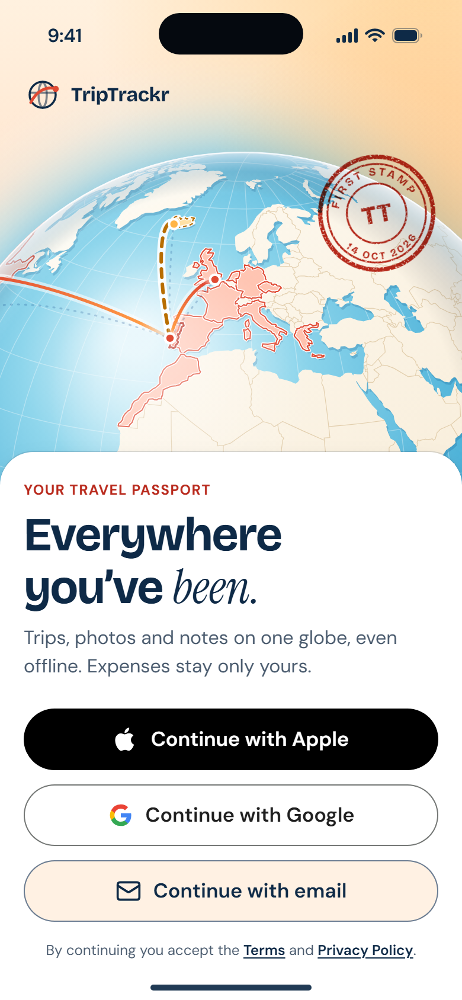
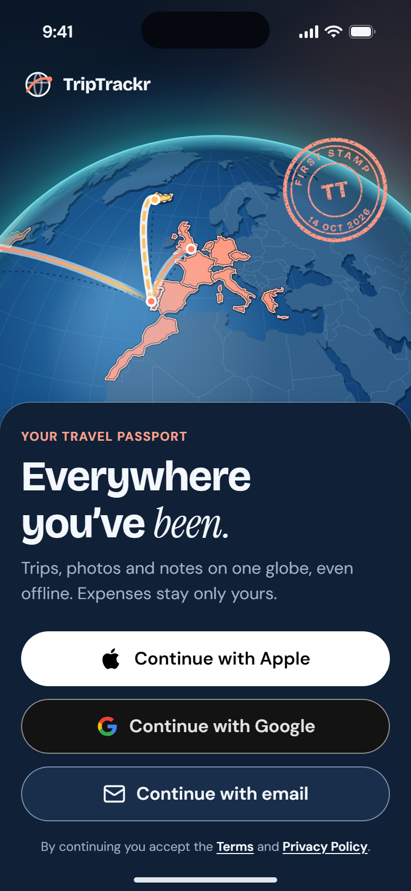
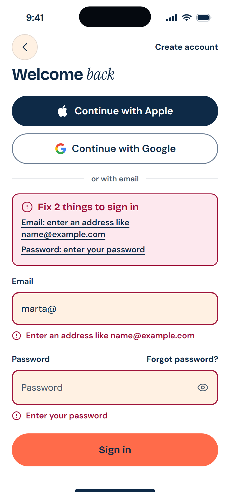
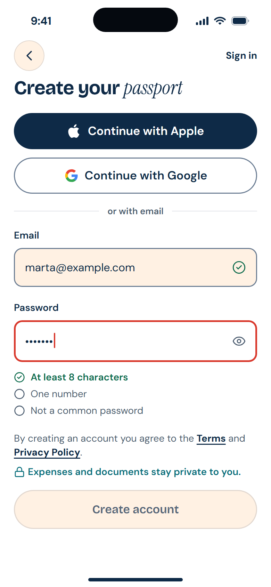

- **Welcome**: the sky with a globe turning behind (static under reduced motion); a 28 dp sheet (padding 24 20 34):
  the wordmark row (32 dp mark + "TripTrackr"), an `eyebrow`, the existing headline "Plan it. Live it. Share what you
  want." with one nested accent word, a short lede, **two buttons**: primary "Create account" (52) and secondary
  "Sign in" (52), and one legal line (12 / 16). **The picture shows three buttons (Apple, Google, email): not built**
  (owner answer Q-5); Apple and Google stay inside the two forms.
- **Sign in / Create account**: Back "Back", fields (email, password; create adds display name and confirm
  password), the primary in the thumb zone, an inline error with an icon, the social buttons under the form (Apple
  on iOS only, Google; equal weight), the visible password rules as helper text.

## 8. You (`(tabs)/profile`)

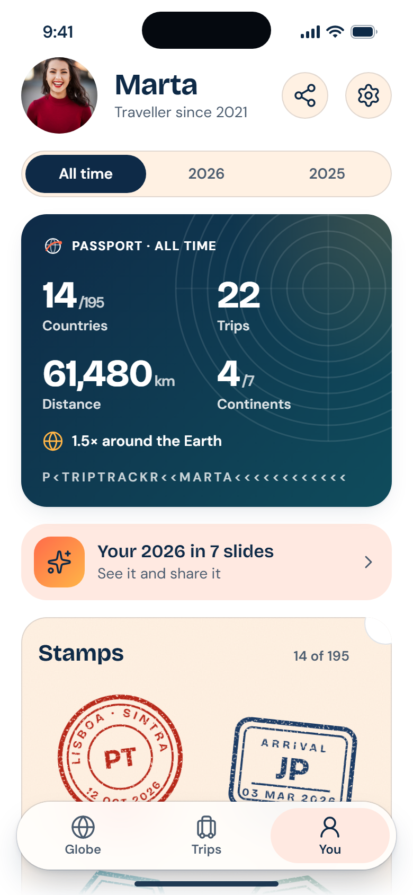
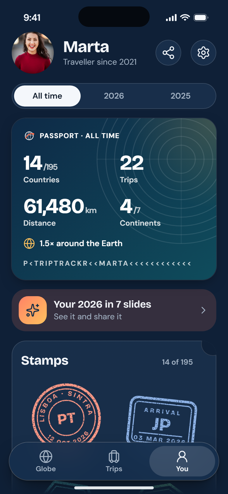
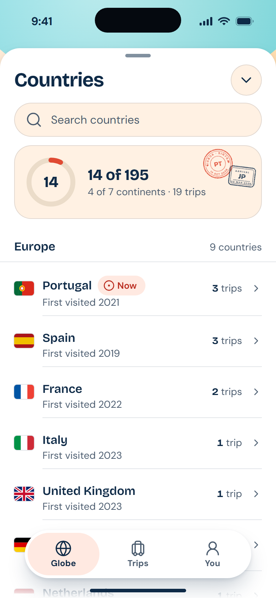

- **Identity**: a 64 dp initials avatar (decorative), the name (`title`), "Traveller since 2021" (`label`, `muted`).
  **Not built**: the share and settings buttons, a profile photograph, the recap entry.
- **Period switch**: All time and each year with a trip (36 dp `SegmentedPill`).
- **Passport card**: "PASSPORT · ALL TIME" `eyebrow`, countries "14 /195", trips, kilometres, continents "4 /7", and
  "1.5× around the Earth"; padding 20, gap 16, radius 24. The 195 and 7 are fixed reference numbers; the numerator is
  the app's existing statistic.
- **Stamps**: "Stamps" and "14 of 195"; two columns of stamps (second column 20 dp lower); stamps earned in the last 7
  days land once per session.
- **Groups**: the existing Account ("Home currency") and App ("Version") groups; Sign out and Delete account in their
  own block, danger ink with an icon; the sign-out guard is unchanged.

## 9. Forms, areas and states

### 9.1 Forms (sheets)

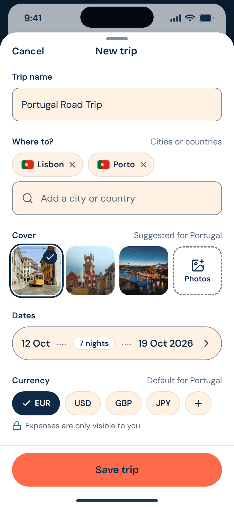
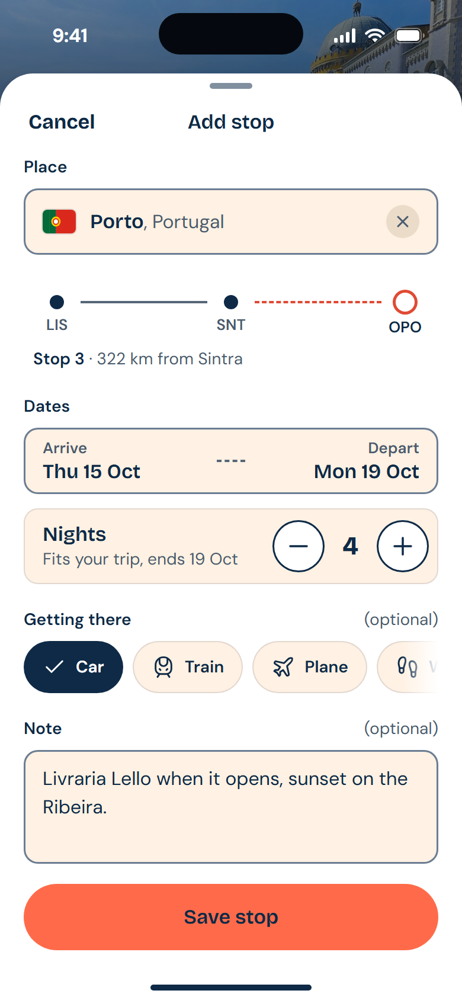
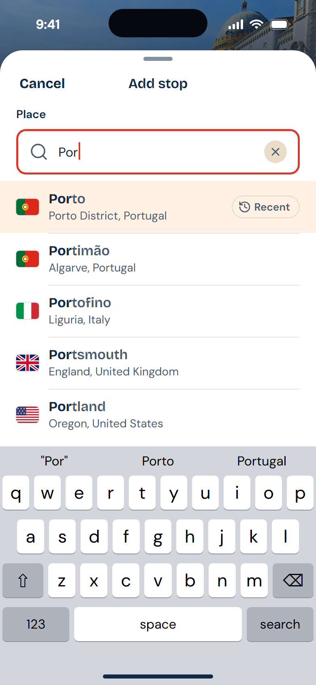
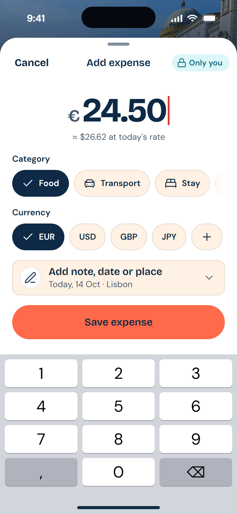

- **New trip**: a form sheet with the name field and the home-currency chip row (one sideways row, "Other"), a note
  "Expenses are only visible to you.", sticky Cancel / Save. **Not built**: the destination, cover and date fields
  of the picture (dates come from stops).
- **Stop editor**: the place field with the city picker (flag chips, region), a route preview (dots, a solid line to
  the previous stop, a dashed coral line to the new one: "Stop 3 · 322 km from Sintra"), the Arrive and Depart date
  fields in one cream block, a **Nights** stepper (44 dp round buttons around a bold number), a sticky "Save stop".
  **Not built**: "Getting there" transport chips and the Note field.
- **Add expense**: the amount first (`display` ~56, tabular, decimal keypad), then category and currency chip rows, note
  and date collapsed, Save above the keypad.
- Every form: the primary is never under the keyboard (`keyboardShouldPersistTaps="handled"`, a keyboard-visibility test).

### 9.2 Everyday areas

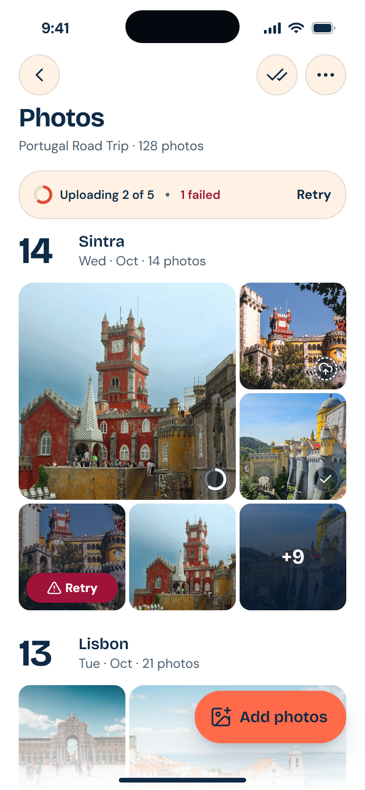
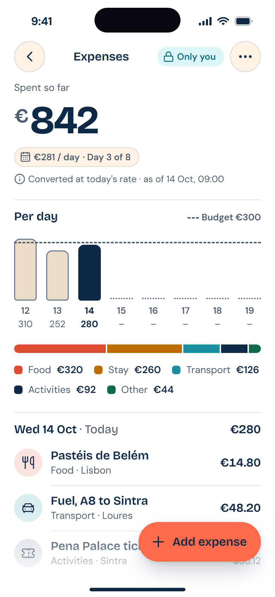
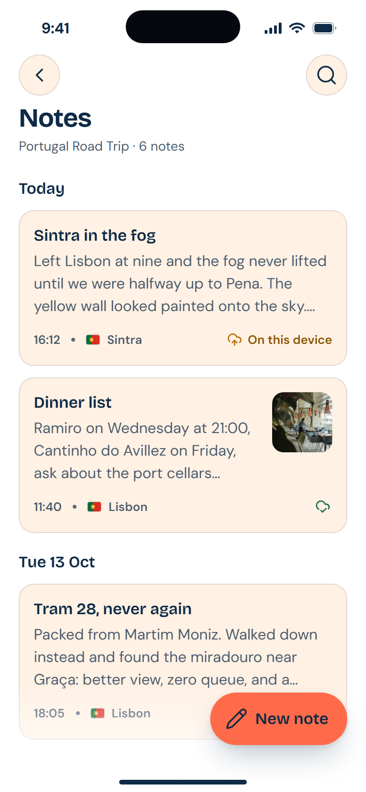
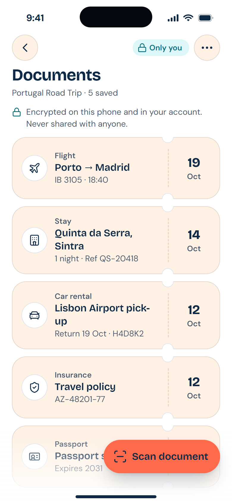
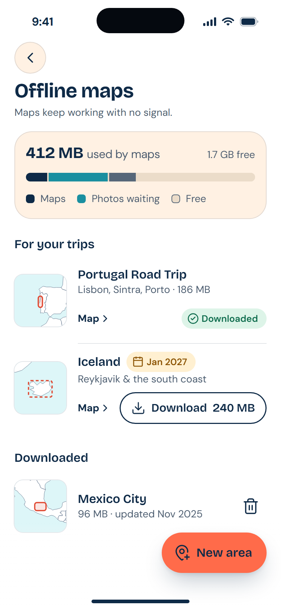
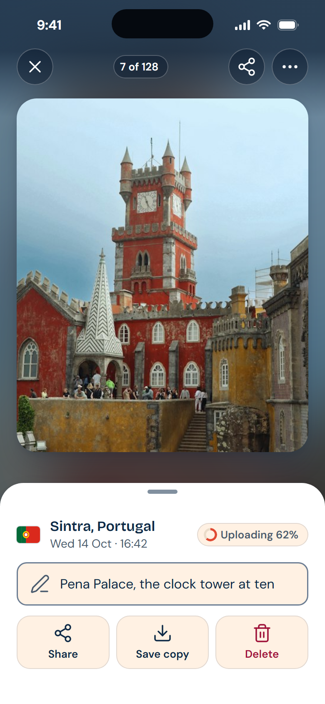
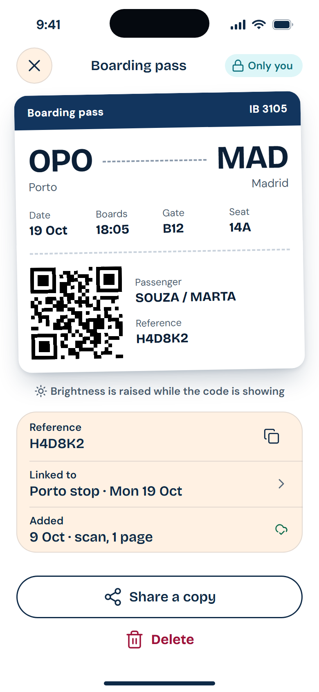

Every area opens with `AreaHeader`: Back (tonal 44 disc at the left), the title (`title`) and a subtitle ("Portugal Road
Trip · 6 notes") under it, and a `PrivacyChip` where the area is private. **Not built**: the search and "more" (…)
buttons at the right of the header, the select-all check in Photos.

- **Photos**: an upload summary pill ("Uploading 2 of 5 · 1 failed · Retry"); per day a `DayHeader` (a big `numeral` day,
  place, weekday and count) and a **mosaic** (one large tile, two stacked, three across; tiles 114 dp, gap 4, radius 16) with per-tile states (uploading ring, uploaded tick, failed "Retry" pill, `+9` count on a full-tile scrim);
  the FAB "Add photos". Empty "No photos yet", skeleton, permission-denied state. No overlay on a thumbnail.
- **Photo viewer**: full-screen photograph, pinch and double-tap zoom, close control named "Close photo", place line.
- **Spending**: "Spent so far" and a large amount (`numeral`, currency symbol raised), a pill "€281 / day · Day 3 of
  8", the rate line with an info icon, **Per day** bars (cream bars with an outline, today solid navy, future dotted,
  day number and amount under each), a segmented **category bar** and legend (Food, Stay, Transport, Activities,
  Other), then expenses grouped by day (category icon on a tint, title, "Category · place", amount at the right);
  the FAB "Add expense". **Not built**: the "Budget €300" line.
- **Notes**: notes grouped by day ("Today", "Tue 13 Oct" as `callout`); each is a cream card (radius 24 or 16, hairline)
  with a title (`callout`), a three-line excerpt (`body`, `muted`), and a foot row: time, a flag and the place at the
  left, the sync state at the right ("On this device" in amber ink with an upload glyph, or a synced tick); a note with
  a photograph shows a 72 dp thumbnail at the top right. The FAB "Add note" (the picture says "New note"; keep the
  app's words). The editor is a sheet with Cancel and Save (no autosave).
- **Documents**: the privacy line, then **ticket** cards (cream, perforated edge with notches, icon disc, kind label,
  title, reference, and the date at the right stub), the FAB "Scan document". The picture draws five kinds (flight,
  stay, car rental, insurance, passport); the app has three (boarding pass → plane, booking → bed, other → document).
  The viewer shows the scan hero, the barcode on a white plate, details and Delete.
- **Offline maps**: a cream storage card ("412 MB used by maps" with "1.7 GB free" at the right, a segmented bar
  Maps / Photos waiting / Free and its legend); "For your trips": one row per trip with a 72 dp map tile, the name
  (and an amber date chip for a planned trip), the places and size, a status pill ("Downloaded" in `successTint`, or an
  outlined "Download 240 MB" button, or its progress); and a note about stops that have no place. **Not built** (unless
  `offline-maps.tsx` already does it): the "Map ›" links, the "Downloaded" list with a delete icon, the "New area" FAB.

### 9.3 States

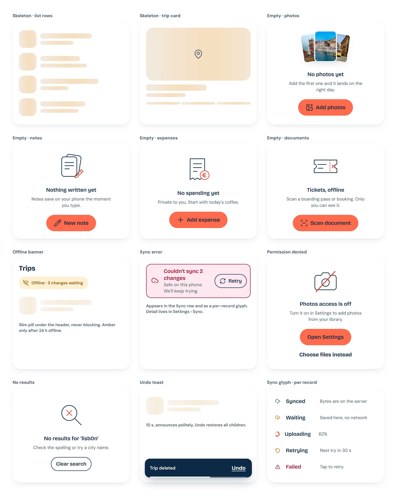
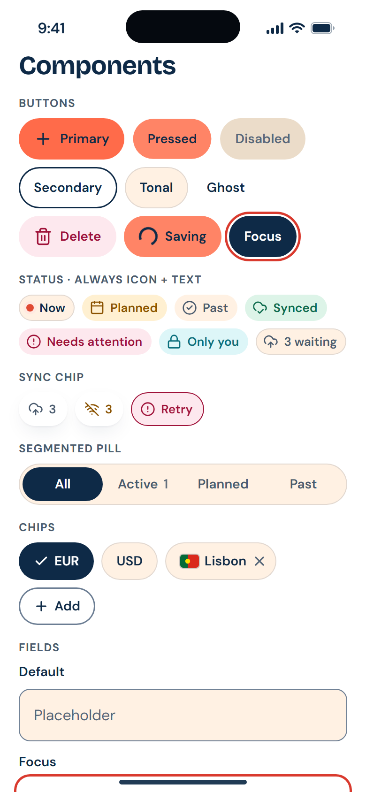
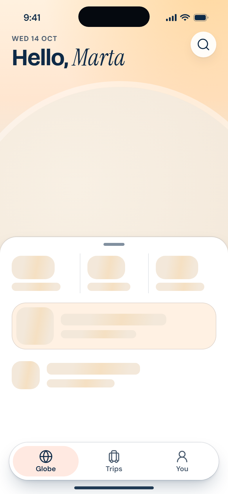
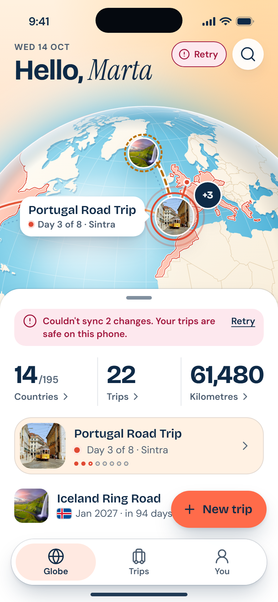

Skeletons mirror their content (warm cream shapes with a faint amber shimmer; **one** progress element each);
empty states say what to do next (for a list: three empty photo frames or a ghost stamp, never an illustration);
errors say the data is safe and offer a verb. Permission-denied screens explain and link to Settings.
`states.png` and `components.png` are the reference for these adapters.

---

## 10. In the pictures but not built

Each of these is drawn in the pictures and must **not** be built or faked with a control that does nothing
(`spec.md` FR-080). Doing one is a separate feature with the capability it names.

| In the pictures                                                                          | Why not                                                 | What it needs                                        |
| ---------------------------------------------------------------------------------------- | ------------------------------------------------------- | ---------------------------------------------------- |
| Search (Home, Trips, Countries), `search*.png`                                           | No search index or recents store                        | A local index and a ranking spec                     |
| Recap, share poster, `recap*.png`                                                        | Sharing is gated by the offline-sync gate               | A sharing spec, export and a security review         |
| Settings (appearance, units, language), `settings*.png`                                  | The app follows the device; no preference store         | A preferences store                                  |
| Permission primers, `permission-primer*.png`                                             | Location and notifications are not product capabilities | The capabilities themselves                          |
| Trip menu, delete confirmation, undo toast, `trip-menu`, `delete-confirm`, `trips-toast` | No trip edit or delete in the UI                        | Edit and delete flows over the 90-day tombstone rule |
| "Find trips in my photos" (Home empty state)                                             | A new library-scan capability                           | Photo-library read, clustering, a confirmation flow  |
| Share, more, search, select-all, List/Map in headers                                     | Capabilities do not exist                               | Each its own feature                                 |
| Offline maps: "New area", "Map ›", delete a pack                                         | Only what `offline-packs.ts` does today exists          | A pack-management spec                               |
| Per-day budget line                                                                      | No budget field                                         | A field and its sync                                 |
| Getting-there chips, drive times, per-stop note                                          | No such stop fields                                     | New stop fields or a routing source                  |
| Document kinds beyond three                                                              | The data has three types                                | New types in the wire contract                       |
| Three-button Welcome                                                                     | Moves sign-in steps the flows rely on                   | An owner decision and new flows                      |
| Profile photograph, brightness boost over a barcode                                      | No picker / native capability                           | New features                                         |

Where the picture's **words** differ from the app's (the FAB says "New trip" in the picture, "Plan a trip" in the app;
Home says "Where to first?"; the picture uses "Planned" and "Now" where the app says "Planning" and "Active"), the
**app's words win**: end-to-end flows assert them (`spec.md` "Copy and label policy"). The accent-word style still
applies by nesting a serif span inside the existing sentence. The only deliberate string change is the third tab:
"Profile" becomes "You" (the id `tab-profile` is unchanged).

## 11. Prototype defects not to reproduce

From `prototype/audit-report.md`: the filter-count "1" at 4.46:1 (use `muted` on cream, 6.29:1); a kilometre figure and
a row title sitting under an overlay (lists pad past the pill and the FAB); the system clock over a hero photograph
(the top scrim). Day chips cut at the edge are intentional scrolling.

## 12. How to check a screen against the pictures

1. Build the dev client and open the screen (the gallery at `/gallery` shows every component in all four themes
   and at two text scales; see `apps/mobile/README.md`).
2. Use a 390 × 844 device or simulator (iPhone 15) for pixel comparison; other sizes are checked for proportion only.
3. Screenshot at 2× and put it over the picture (Figma overlay at 50%, or an image diff). Tolerances: **spacing and
   sizes within 1 dp, colours exactly the tokens, type roles exactly the table in 2.2**, radii exact. Photographs and
   the globe differ by design (own photos, Mapbox).
4. Repeat for `-dark`, `-contrast`, `-android`, `-scale2` and `-long` where a picture exists.
5. Record what differs and why in `tasks.md` under the task. A difference without a reason is a bug.
